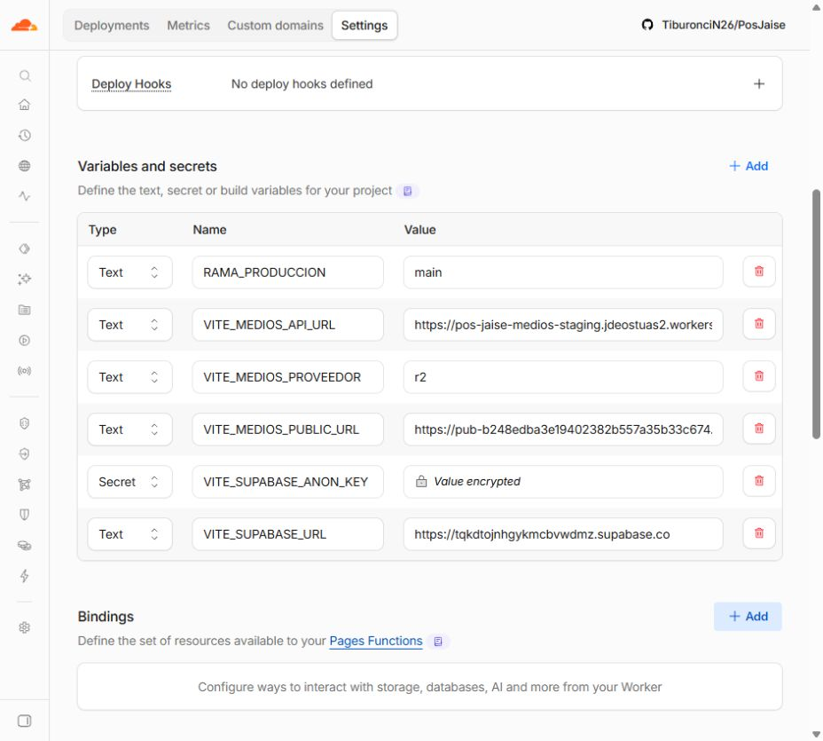
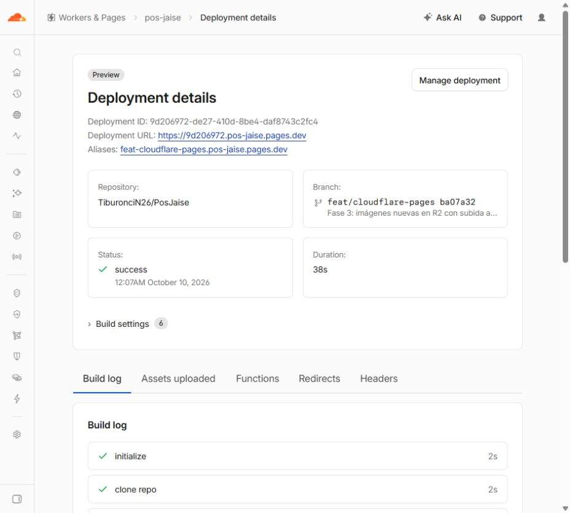

# Pages Preview: R2 configurado y publicado — resultado para Claude

Fecha local: 10 de octubre de 2026, America/Lima.

**Hecho:** las tres variables de medios se guardaron exclusivamente en Preview del proyecto `pos-jaise`. Se reconstruyó el commit publicado `ba07a32` desde el panel y el alias ya contiene el proveedor R2 y sus endpoints de staging. **No hace falta un commit adicional para activar estas variables.** Un commit posterior de documentación, si Claude lo realiza dentro de su autorización, será una publicación nueva que deberá validarse por separado.

## Variables y entorno verificados

| Variable de Preview | Valor |
|---|---|
| VITE_MEDIOS_PROVEEDOR | r2 |
| VITE_MEDIOS_API_URL | https://pos-jaise-medios-staging.jdeostuas2.workers.dev |
| VITE_MEDIOS_PUBLIC_URL | https://pub-b248edba3e19402382b557a35b33c674.r2.dev |

Se conservaron `RAMA_PRODUCCION=main`, `VITE_SUPABASE_URL=https://tqkdtojnhgykmcbvwdmz.supabase.co` y la anon key cifrada existente. No se abrió ni volvió a cargar su valor. Los tres valores nuevos son Text, sin barras finales ni tokens de R2.

Se comprobó Production antes y después: conserva únicamente `RAMA_PRODUCCION=main`, rama de producción main y despliegues automáticos Disabled. No se guardó nada en ese entorno.

Nota del panel: los ids HTML de los componentes de variables contienen la palabra production incluso en la ruta Preview. El entorno se verificó por la ruta `/settings/preview`, su control de ramas Preview y la lista existente con Supabase de staging; después se contrastó la ruta `/settings/production`, con su única variable original.

## Build nuevo, sin push de Codex

- Acción: **Retry deployment** únicamente del Preview `feat/cloudflare-pages` correspondiente a `ba07a32`.
- Commit: **ba07a32a78bcbad12f594e9fc842b49640d42b61**.
- Deployment nuevo: **9d206972-de27-410d-8be4-daf8743c2fc4**.
- Estado: **success**, duración mostrada **38 s**.
- Alias canónico: **https://feat-cloudflare-pages.pos-jaise.pages.dev**.
- URL inmutable: **https://9d206972.pos-jaise.pages.dev**.
- El log confirma `entorno=preview rama=feat/cloudflare-pages backend=staging clave=jwt-anon`.
- Build ejecutado en Cloudflare con Node **22.22.0**. Persiste la advertencia conocida de `@zxing/library` que declara Node >=24; no bloqueó la compilación y el escáner físico no se probó.

## Comprobación independiente del artefacto servido

Se descargaron en solo lectura HTML, SW y **140 scripts JS** del precache/entrada del alias. La evidencia guarda estados, hashes y resultados, sin valores de claves.

| Comprobación | Resultado |
|---|---|
| build-id | ba07a32a |
| Proveedor compilado | r2 |
| URL del Worker de staging | Presente |
| URL pública r2.dev del bucket de pruebas | Presente |
| Ref de Supabase de staging | Presente |
| Ref del negocio | Ausente |
| Supabase local 127.0.0.1:54321 | Ausente |
| Barrido de claves privilegiadas/backend ajeno | Sin hallazgos |
| Scripts consultados | Todos HTTP 200 |
| /ventas por URL directa | HTTP 200 |
| Manifest scope/start_url | / |
| 404.html precacheado | Ausente |
| pos-jaise.pages.dev (Production) | HTTP 404; sin build público de producción |

Cabeceras del alias: HTML `public, max-age=0, must-revalidate`, SW `no-cache`, `X-Robots-Tag: noindex`. Continúan las observaciones anteriores de caché del HTML/CSP.

La primera expresión regular del diagnóstico no reconocía el literal de plantilla que genera el minificador para el proveedor. Se corrigió únicamente el diagnóstico externo para aceptar las tres formas de literal JS y comprobarlo en los módulos que contienen ambos endpoints. El resultado final es correcto; no se modificó código de la aplicación.

## PWA y versiones

El commit se recompiló con variables distintas: conserva **el mismo build-id ba07a32a**, pero el artefacto y sus scripts cambiaron. Los service workers de las dos URLs inmutables son distintos:

- Antes: `https://21c2a315.pos-jaise.pages.dev`, SW SHA-256 `bb8eeb37ec3ef65cc03a8612aa4d36aba57e56aea8607acb6a9c32773f8d4f46`.
- Ahora: `https://9d206972.pos-jaise.pages.dev`, SW SHA-256 `cb550bd02f31857e574daef26361b4b19f8f4f1db693c2908388c6d77bc417f5`.

No identificar estas dos compilaciones solo por el meta build-id. En las pruebas de interfaz usar un contexto nuevo o resolver el aviso de actualización sin trabajo pendiente, para evitar seguir ejecutando el bundle anterior que subía a Supabase. Aquí se comprobó la diferencia de SW, no se repitió la prueba interactiva O1 de actualización.

## Qué puede continuar Claude

La configuración y el build están hechos: puede verificar la misma publicación y preparar las pruebas de interfaz en **el alias canónico** con datos QA ficticios de staging. Ese origen está autorizado en el Worker. La URL inmutable se guarda como evidencia; no añadirla al CORS ni usarla para subidas sin una decisión específica.

No se realizaron logins, subidas, borrados, ventas, pagos ni escrituras de tablas de staging durante esta verificación del alias. No se configuró CORS del bucket ni se amplió el CORS del Worker. Siguen pendientes las pruebas de interfaz/fotos de catálogo/navegadores/móvil, CDN/dominio propio/nosniff definitivo, purga, recolector destructivo y migración inversa. No se cerró la Fase 3 completa.

## Git y documentación

Se verificaron localmente el commit de 39 archivos, la corrección del B6 con comparación binaria/SHA-256 de m/g y el check completo del parche de rollback (pasa; sin aplicar). No se volvió a ejecutar la corrida real con escritura ni el npm ci de Claude.

HEAD de trabajo: `ba07a32a78bcbad12f594e9fc842b49640d42b61`; main local: `0dc629e430ed07eeaccec273d31de93e9717d9bf`. Referencias remotas locales consultadas: origin/feat/cloudflare-pages = ba07a32; origin/testing = `ce21b89b83821eb8ddab207db77c6799dea40bb6`. La rama local testing sigue en 0dc629e; no confundirla con su referencia remota. Codex no realizó fetch, commit, push ni cambios de Git.

Este informe es nuevo dentro de .codex; no se sobrescribió el traspaso ni se editaron runbook/changelog/fuentes. Claude puede registrar estos resultados en su documentación como considere dentro de la autorización vigente.
