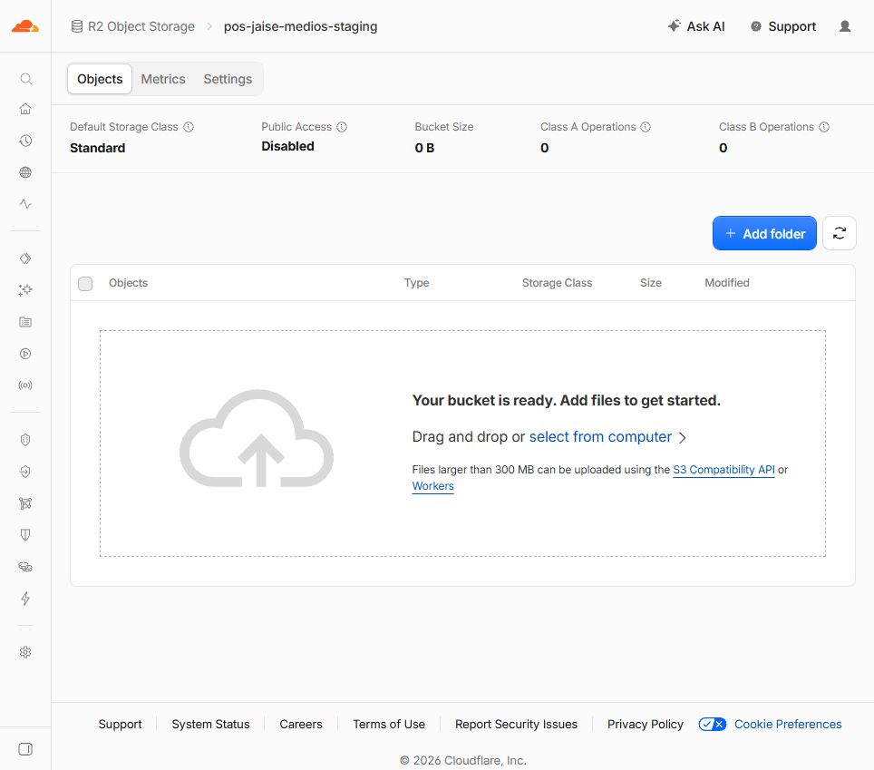

# R2: bucket de pruebas creado

Fecha local: 9 de octubre de 2026, America/Lima.

El usuario confirmó que había activado R2 y autorizó a Codex a crear el bucket con «haslo tu», después de identificar el nombre `pos-jaise-medios-staging`. La creación se realizó mediante el navegador integrado en su sesión de Cloudflare.

## Resultado verificado en el panel

- Bucket: **pos-jaise-medios-staging**.
- Default Storage Class: **Standard**.
- Ubicación: opción **Automatic**; el formulario mostró Eastern North America como ubicación elegida por Cloudflare.
- Public Access: **Disabled**.
- Bucket Size: **0 B**, sin objetos.
- El panel mostró «Your bucket is ready. Add files to get started».

## Alcance y siguiente paso

Se creó únicamente este bucket de staging. No se subieron archivos, habilitó acceso público/r2.dev, creó un Worker, generó un token, modificó Pages/GitHub/Supabase ni realizó commit/push.

El usuario eligió conservar Pages para la web y posponer la compra de un dominio. Para las fotos de prueba se acordó usar temporalmente la URL pública de desarrollo r2.dev. **Todavía falta habilitarla**; será un paso separado. La prueba de caché CDN con dominio propio permanece pendiente.

El runbook y las entregas anteriores que dicen «R2 no habilitado / sin bucket» describen el estado histórico. Codex no modificó esos documentos; este registro documenta el estado nuevo para Claude.

No hay claves ni datos de tarjeta en este informe. No se tocó la fila residual ni las cuentas QA de staging.
