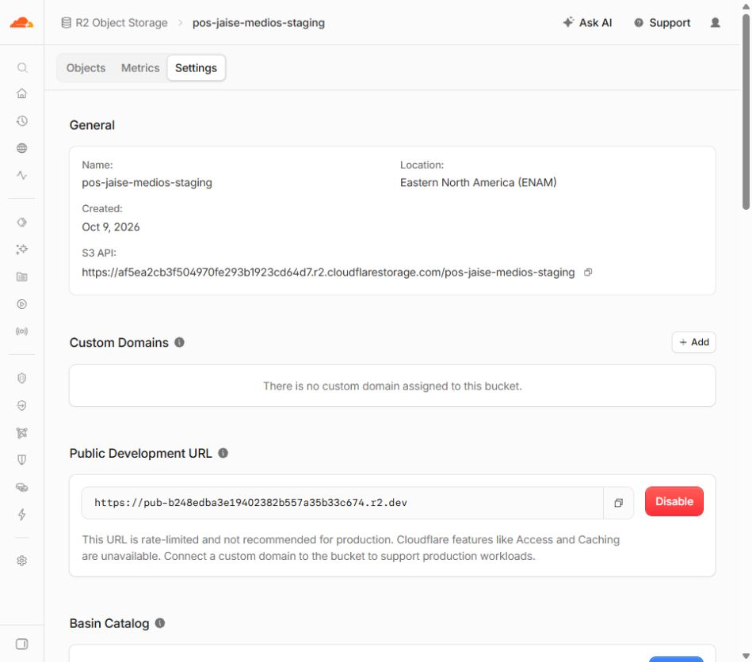

# R2: URL pública de pruebas habilitada

Fecha local: 9 de octubre de 2026, America/Lima.

El usuario autorizó habilitar la URL de desarrollo r2.dev del bucket `pos-jaise-medios-staging` con «si haslo», después de crear el bucket y de identificar este paso como el siguiente. Se habilitó desde Settings → Public Development URL → Enable en el navegador integrado.

## Resultado verificado

- Bucket: **pos-jaise-medios-staging**, almacenamiento Standard.
- URL pública: **https://pub-b248edba3e19402382b557a35b33c674.r2.dev**.
- El panel muestra la URL y el botón **Disable**, que confirma su habilitación.
- El bucket estaba vacío antes de la acción; no se subieron archivos.
- No existe dominio propio asociado.
- CORS sigue sin política configurada.

Esta URL permite lectura pública de los objetos del bucket. La subida autenticada de la aplicación todavía requiere desplegar y probar el Worker. El propio panel indica que r2.dev está limitado para desarrollo y no proporciona las funciones de Cloudflare Access ni caché CDN; la validación de caché con dominio propio continúa pendiente.

## Alcance

Se cambió únicamente Public Development URL de este bucket de staging. No se crearon secretos/tokens, desplegó el Worker, modificó CORS, Pages, GitHub, Supabase o código, ni hubo commit/push. No se tocaron datos del negocio ni la fila/cuentas QA residuales.

Para la configuración futura de Preview, el valor público previsto de `VITE_MEDIOS_PUBLIC_URL` es la URL anterior. **Todavía no se configuró esa variable en Pages**; `VITE_MEDIOS_API_URL` espera al Worker. No se ejecutó el verificador de R2 real ni pruebas con escritura.

El registro anterior `R2-BUCKET-STAGING-CREADO.md` conserva el estado al momento de creación, cuando el acceso público estaba deshabilitado. Este informe documenta el cambio posterior autorizado y no sobrescribe los informes anteriores.
