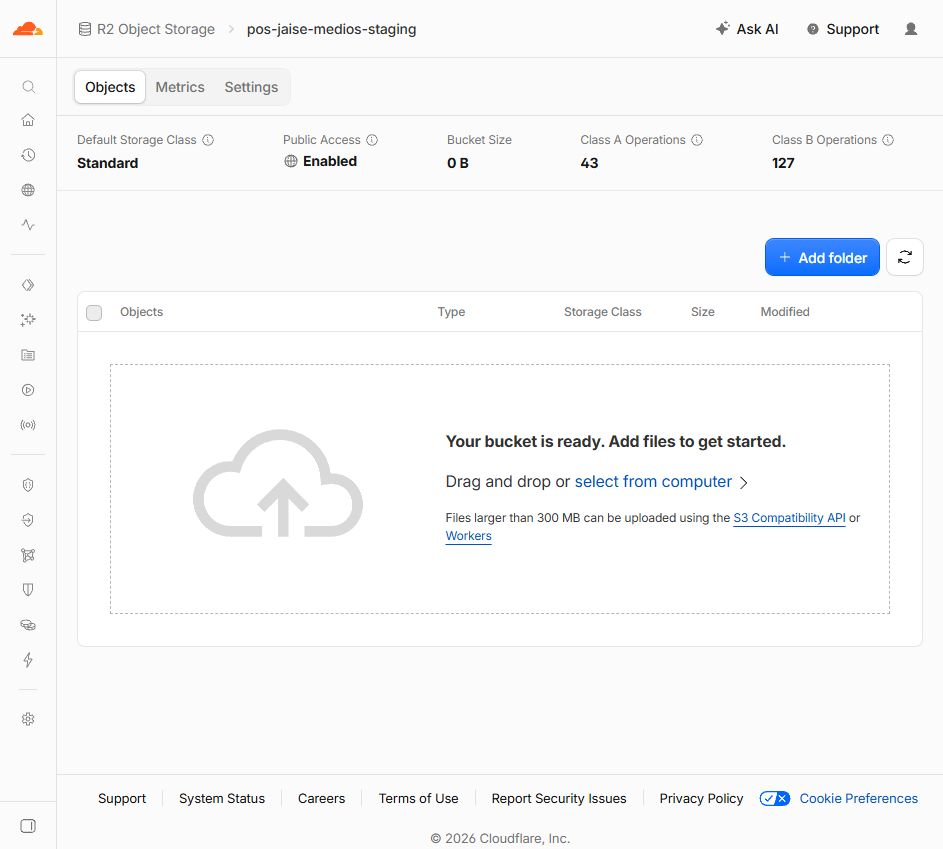
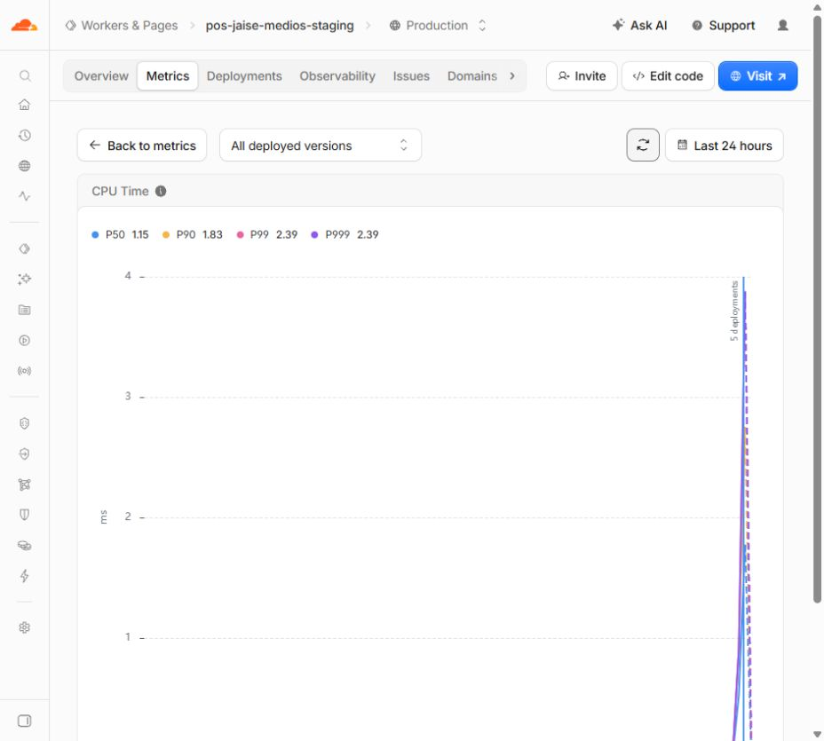

# Fase 3: revisión de R2 real y preparación de commit para Preview

Fecha local: 9 de octubre de 2026, America/Lima. Evidencia fechada en UTC.

**Recomendación: avanzar únicamente al preview de staging, con dos ajustes de evidencia antes del push.** No se encontró un nuevo bloqueo de funcionamiento en la implementación aceptada en V5. Esta revisión no equivale a la aceptación de producción ni al cierre completo de Fase 3, y no concede autorización humana para commit/push.

## Evidencia revisada y comprobaciones propias

- Claude registra **8/8 casos sin escritura y 30/30 con escritura**, sin fallos, contra el Worker y r2.dev correctos. Se auditaron los JSON y el script; Codex **no presenció ni repitió las 30 pruebas con escritura** en esta revisión.
- La evidencia registra 4 fotos de referencia del repositorio, miniaturas de 3,8–9,3 KiB y detalle de 8,3–22,2 KiB. No es una muestra del catálogo del negocio. Las medianas de lectura registradas son 138–147 ms por foto en esa corrida, no una garantía de latencia para todos los clientes.
- Los 4 grupos creados por el script registran DELETE 200 y lectura pública posterior 404.
- **Codex comprobó directamente el bucket completo en el panel: vacío, 0 B.** En el momento de la captura, el panel mostraba 43 operaciones clase A y 127 clase B. Son contadores observados, no un cálculo de factura.
- El paquete del Worker sigue con SHA-256 `A960C31C5B7431C4A2795BAB4A0BE028955598BF7FEBEFAF402221857FE86084`.
- Las fuentes cubiertas por los hashes de V5 no han cambiado. Por ello no se repitieron las 166 pruebas locales de funcionamiento ya aceptadas.

## CPU real observada por Codex

En Workers → pos-jaise-medios-staging → Metrics → CPU Time, tras actualizar una vez la ventana **Last 24 hours / All deployed versions**, el panel mostró:

| Percentil agregado visible | CPU |
|---|---:|
| P50 | 1,15 ms |
| P90 | 1,83 ms |
| P99 | 2,39 ms |
| P999 | 2,39 ms |

El intervalo reciente que el texto accesible del gráfico expone registra P99 3,878 ms. La captura y el texto accesible se guardan como evidencia. No confundir el percentil agregado con un máximo por solicitud ni con medición exclusiva de PUT: la ventana incluye las peticiones de configuración, autorizaciones y pruebas.

La muestra observada está por debajo del límite Free de 10 ms de CPU por solicitud, confirmado en la [documentación oficial de Cloudflare](https://developers.cloudflare.com/workers/platform/limits/#cpu-time). Es suficiente para seguir probando el preview; no demuestra el rendimiento con fotos grandes del catálogo ni bajo concurrencia/carga sostenida. Esa comprobación continúa pendiente.

## Listado concreto para revisar/publicar

Se identificaron **38 candidatos de Fase 3: 9 modificados y 29 nuevos**. El listado exacto y sus hashes están en `evidencia-r2-real-revision/commit-fase3-propuesto.json`.

El listado incorpora los cambios de la app, helper de reconciliación/medios, Worker fuente y configuración, package/lock propios del Worker, pruebas, documentación y evidencia de la Fase 3. **Excluye** informes/evidencia de `.codex`, las 3 capturas antiguas de Fase 1 y los archivos ignorados de entorno, dist, node_modules y estado local.

El barrido de estos 38 archivos no detectó claves privilegiadas, tokens reales con roles privilegiados, contraseñas literales, claves privadas ni URLs de base de datos con contraseña. Se reportan ubicaciones/tipos sin revelar valores. Es una búsqueda por patrones, no una garantía absoluta contra cualquier secreto imaginable.

El repositorio sigue siendo público: los nombres y URLs del Worker/bucket/r2.dev de staging, ref de Supabase de staging y referencias QA ficticias incluidas en estos documentos quedarán visibles al hacer push. Son identificadores, no claves de acceso. No usar `git add .`; seleccionar el listado de Fase 3.

### Build desde los candidatos

Se creó una copia externa de **git archive HEAD + solo los 38 candidatos**, sin copiar `.env` ni capturas/informes no propuestos. Se compiló con backend de staging y las tres variables R2 del preview previstas:

- `VITE_MEDIOS_PROVEEDOR=r2`.
- `VITE_MEDIOS_API_URL=https://pos-jaise-medios-staging.jdeostuas2.workers.dev`.
- `VITE_MEDIOS_PUBLIC_URL=https://pub-b248edba3e19402382b557a35b33c674.r2.dev`.

Resultado: **build pasa**, 179 archivos, base raíz, sin 404.html ni su precache, sin credenciales privilegiadas/backend ajeno en el barrido de salida. Se usaron las dependencias ya instaladas, enlazadas a la copia; no se instaló nada ni se ejecutó un npm ci nuevo. El lanzador de diagnóstico usa configuración nativa de Vite, raíz/caché/salida externas, y reproduce el copiado de _headers/eliminación de 404.html en su salida externa.

Esto verifica que el listado propuesto contiene los archivos necesarios para compilar; **Claude debe verificar después el commit exacto desde un checkout limpio antes del push**, con sus dependencias del lock. El build revisado no autoriza fusionar a main.

## Dos ajustes concretos para Claude

### R2-R1 / P2 — rollback desactualizado en .gitignore

El comando completo

`git apply -R --check docs/evidencia-rendimiento/fase-3/rollback/fase-3-archivos-modificados.patch`

**falla en .gitignore:74**. El parche todavía representa el hunk de 8 líneas; el diff actual tiene 9 porque se añadió `cloudflare/medios-worker/dist/`. El mismo check con `--exclude=.gitignore` pasa, por lo que la discrepancia queda localizada.

Recomendación: regenerar solo el rollback de esta fase incluyendo esa exclusión y repetir el check completo, sin aplicar el parche ni restaurar archivos. Corregir cualquier afirmación documental de que el check actual ya pasa. No cambia el comportamiento de la aplicación.

### R2-R2 / P2 — «bytes idénticos» todavía compara solo longitud

En `scripts/verificar-r2-real-fase3.mjs:210–212`, el caso B6 usa `ultima.bytes === img.m.length`. Dos cuerpos distintos del mismo tamaño pasan esa condición. La variante g se consulta pero, actualmente, solo su status 200 genera la comprobación/fallo.

Recomendación: comparar el contenido de ambas variantes (`ultima.cuerpo` con `img.m`, y `gg.cuerpo` con `img.g`) con comparación byte a byte o hash; comprobar su tipo y cabeceras según el entorno. Mientras eso no exista, rotular la evidencia como «mismo tamaño» y no como igualdad binaria probada.

No se halló corrupción de archivos en esta revisión: es una carencia de la prueba y de la precisión de su etiqueta. El ajuste de nosniff para r2.dev es razonable en este entorno de desarrollo: conserva la advertencia y la exigencia para dominio propio; no convierte r2.dev en un hosting de medios aceptado para producción.

## Condiciones para el siguiente paso

La autorización humana, si el usuario la concede a Claude, debe limitarse a:

1. Corregir estos dos detalles y actualizar la evidencia/listado si cambian archivos.
2. Commit y push **solo a feat/cloudflare-pages**, seleccionando únicamente la Fase 3. HEAD revisado `940510543f629df11ce80d558399c7ef32bebb68`; main `0dc629e430ed07eeaccec273d31de93e9717d9bf`.
3. Configurar `VITE_MEDIOS_*` **solo en Preview** del proyecto Pages pos-jaise, con los endpoints de staging anteriores. Mantener el Supabase de staging y las salvaguardas del build.
4. Probar la interfaz con datos QA ficticios de staging; revisar sesiones, nuevas y antiguas fotos, edición/borrado y actualización PWA. La operación de negocio y los pagos siguen fuera del alcance.

El workflow de GitHub Pages inspeccionado se dispara en push a main; un push solo a feat/cloudflare-pages no modifica esa rama. El hosting definitivo y retiro de GitHub Pages siguen pendientes del cierre de la guía.

Siguen abiertos dominio propio/CDN, nosniff público definitivo, muestra del catálogo, Firefox/Safari/móvil, purga de caché, uso destructivo del recolector y migración inversa. La fila residual de staging y las cuentas QA siguen intactas en esta revisión.

Codex no aplicó parches, modificó código, instaló dependencias, subió/borró objetos, cambió variables de Pages, hizo commit/push ni modificó datos del negocio. Se crean únicamente este informe y evidencia en .codex.
