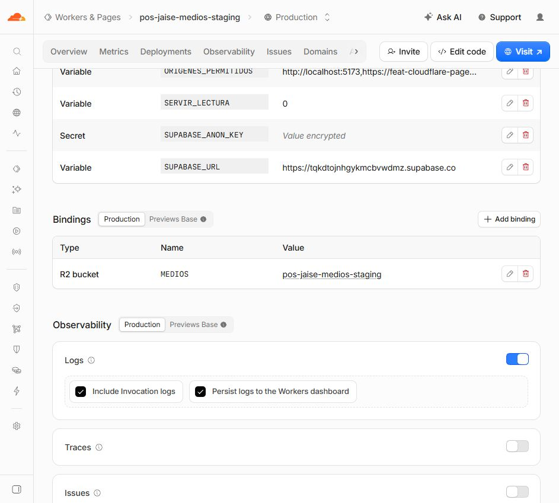
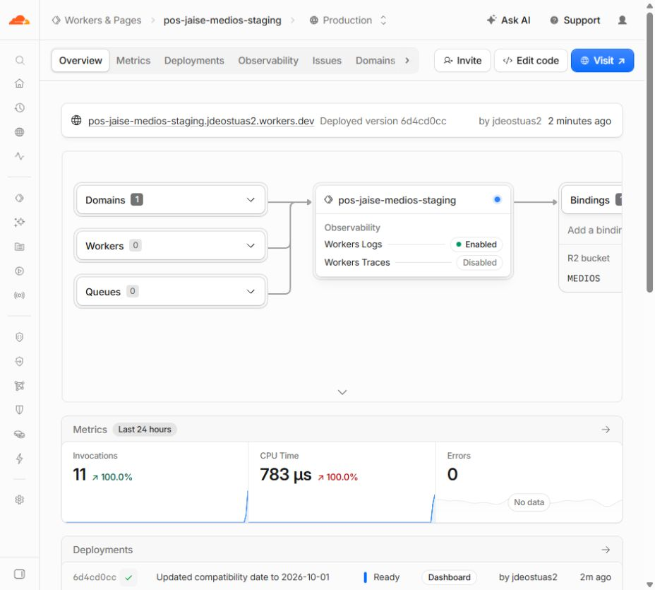

# Worker de medios de staging publicado por Codex

Fecha local: 9 de octubre de 2026, America/Lima. Evidencia de pruebas en UTC.

El usuario eligió el despliegue por panel y autorizó a Codex con «ok haslo», después de explicarse que se crearía únicamente `pos-jaise-medios-staging`, con el código preparado por Claude, el bucket de pruebas y el Supabase de staging.

## Estado publicado

- Worker: **pos-jaise-medios-staging**.
- API: **https://pos-jaise-medios-staging.jdeostuas2.workers.dev**.
- Versión final activa: **6d4cd0cc-41da-46a9-8b97-09714339579c**, estado Ready y 100 % en el panel.
- Código: `cloudflare/medios-worker/dist/index.js`, preparado por Claude; 15 530 bytes.
- SHA-256 del paquete, estable antes y después: `A960C31C5B7431C4A2795BAB4A0BE028955598BF7FEBEFAF402221857FE86084`.
- El contenido pegado en el editor se copió mediante la UI y se comparó con el paquete local: coincidencia exacta normalizando finales de línea.
- Fecha de compatibilidad: **2026-10-01**, igual a `wrangler.toml`; sin flags adicionales.
- Binding R2: **MEDIOS → pos-jaise-medios-staging**.
- Lectura pública de fotos: **https://pub-b248edba3e19402382b557a35b33c674.r2.dev**.

El panel denomina «Production» a la instancia activa de este Worker. Se trata del servicio cuyo nombre y configuración son de **staging**; no es el backend del negocio ni el proyecto Pages de producción.

## Variables verificadas en el panel

| Nombre | Tipo | Valor / verificación |
|---|---|---|
| AMBIENTE | Variable | staging |
| SUPABASE_URL | Variable | https://tqkdtojnhgykmcbvwdmz.supabase.co |
| ORIGENES_PERMITIDOS | Variable | http://localhost:5173,https://feat-cloudflare-pages.pos-jaise.pages.dev |
| SERVIR_LECTURA | Variable | 0 |
| SUPABASE_ANON_KEY | Secret | Value encrypted; tomada de `.env.staging.local` sin mostrar su valor |

Antes de cargar la clave se verificaron URL exacta de staging y clasificación de clave pública/anon (rechazo de clave privilegiada, role distinto de anon o ref diferente). No se usó service_role, token de API de Cloudflare ni OAuth de Wrangler. No se modificó `.env.staging.local`.

## Verificación independiente sin escritura

Se ejecutó una copia externa de `scripts/verificar-r2-real-fase3.mjs` **sin --escribir**. Solo se adaptaron importación, raíz del repositorio y destino de resultados para no modificar archivos del proyecto.

**8 casos, 0 fallos:**

- PUT sin sesión: 401.
- Inventario sin sesión: 401.
- Origen ajeno: 403.
- Preflight del origen de Pages: 204, origen exacto, sin comodín.
- Preflight ajeno: 403 y sin Allow-Origin.
- Destino de comprobantes en el Worker: 400.
- Ruta de comprobante inexistente en el dominio público: 404.
- Foto inexistente en el dominio público: 404.

No se subieron ni borraron objetos. La comprobación de una ruta inexistente no sustituye a una revisión de la privacidad de archivos reales: este bucket está destinado exclusivamente a medios públicos de catálogo/galería.

Se añadieron **3 comprobaciones de roles en solo lectura** con las cuentas QA ficticias existentes de staging:

| Rol | GET de inventario | Resultado |
|---|---:|---|
| Admin | 200 | Inventario vacío (0 objetos del destino consultado) |
| Cajera | 403 | Acceso denegado |
| Cliente | 403 | Acceso denegado |

En los tres casos, CORS devolvió el origen exacto de Pages. Esto comprueba el funcionamiento real de Auth/es_admin, la clave de staging y el binding R2 para lectura. Contraseñas y tokens no se imprimieron ni guardaron en la evidencia.

El widget del panel mostraba 11 invocaciones, CPU Time 783 µs y 0 errores al capturar la evidencia. Es una observación de las primeras solicitudes de configuración/lectura, **no una medición de CPU de procesamiento/subida de fotos**, ni un certificado de costo o rendimiento bajo carga.

## Qué queda para Claude

1. Registrar este despliegue real; los textos «sin Worker / sin sesión» del runbook describen el estado previo. La sesión de Wrangler sigue sin configurarse; el despliegue se hizo por panel.
2. Para futuras variables de Pages Preview, los valores preparados son:
   - `VITE_MEDIOS_PROVEEDOR=r2`.
   - `VITE_MEDIOS_API_URL=https://pos-jaise-medios-staging.jdeostuas2.workers.dev`.
   - `VITE_MEDIOS_PUBLIC_URL=https://pub-b248edba3e19402382b557a35b33c674.r2.dev`.
   **Codex no las configuró en Pages ni autorizó commit/push con esta acción.**
3. Pruebas de subidas, reintentos, borrado propio, fotos de catálogo, navegadores y móvil: pendientes. El modo `--escribir` no se ejecutó.
4. CORS del bucket R2 continúa sin configurar; se verificó el CORS del Worker. La URL r2.dev no permite cerrar la prueba de caché CDN con dominio propio.
5. Migración inversa, purga de caché y operación destructiva del recolector siguen abiertas. No escribir referencias r2: en datos del negocio ni retirar GitHub Pages todavía.

## Alcance y recuperación

Se creó/configuró únicamente este Worker de staging mediante el panel. Cloudflare exige crear primero un Worker básico; esa versión inicial `e59a1836` fue reemplazada por el paquete de medios (`da145bca`), después binding, variables/secreto y compatibilidad. La versión activa final es `6d4cd0cc…`.

No se modificaron fuentes, dependencias, migraciones, Supabase del negocio, Pages, DNS, GitHub Pages, main ni cuentas/fila QA residuales. HEAD permanece `940510543f629df11ce80d558399c7ef32bebb68`; main `0dc629e430ed07eeaccec273d31de93e9717d9bf`. Sin commit/push de Codex.

Si se necesita detener este endpoint, deshabilitar su workers.dev o retirar solo este Worker de pruebas es una acción posterior que requiere indicación del usuario. No se ejecutó rollback, ni eliminación del bucket/Worker.
